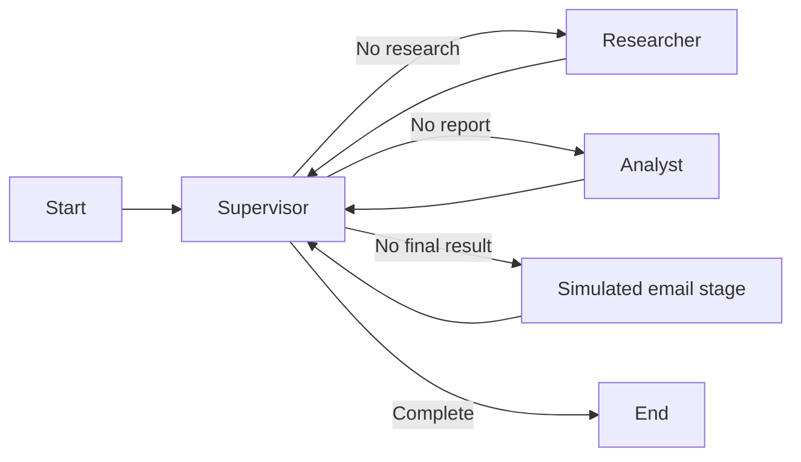
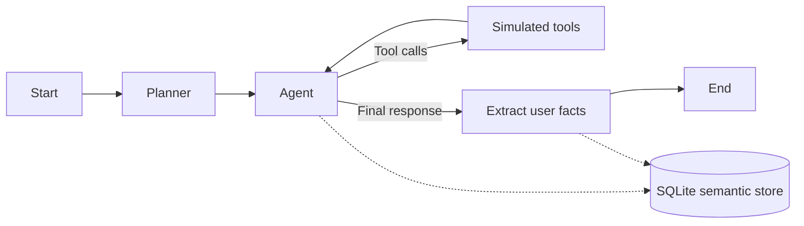

# LangGraph Agent Patterns

Two educational Python examples of stateful agent workflows: a supervisor that coordinates three stages, and a planning/tool loop with SQLite checkpoints and semantic memory.

**Status: learning examples, not production applications.** Search, review, email, and account tools return clearly labeled fixed demonstration responses. They do not browse the web, send email, or query financial systems. Explicitly running the examples uses the configured Gemini API for language-model responses; the memory example also uses its embedding API.

## What the examples demonstrate

| Example                          | Implemented pattern                                                                                                   | Runtime dependencies                                                        |
| -------------------------------- | --------------------------------------------------------------------------------------------------------------------- | --------------------------------------------------------------------------- |
| [`a.py`](a.py)                   | Supervisor routing through researcher, analyst, and simulated email stages using `Command`                            | Gemini chat model with tool support                                         |
| [`project.py`](project.py)       | Structured planning, model/tool loop, message accumulation, checkpointed threads, and user-namespaced semantic memory | Gemini chat/embedding models and local SQLite with vector-extension support |
| [`tool_stubs.py`](tool_stubs.py) | Deterministic, explicitly simulated tool responses                                                                    | No external services                                                        |

The scripts are safe to import: importing them does not load `.env`, initialize model clients, open databases, or run a workflow. Model/client setup and execution are behind `main` guards.

### Supervisor workflow



The supervisor decides the next stage from state fields. Each agent receives the preceding stage's text through the expected `messages` input. The final result is explicitly marked as a simulation. No email service is implemented.

### Planning and memory workflow



The checkpoint database stores graph/thread history. A separate vector-enabled SQLite store holds extracted user facts under a user namespace. Memory extraction is model-based and can make mistakes; it is not an authoritative profile or an authentication system.

## Setup

Use Python 3.10 or newer. The recorded offline checks used Python 3.10.10 on Windows.

From this project directory:

```sh
python -m venv .venv
```

Activate the environment with `source .venv/bin/activate` on POSIX shells or `.\.venv\Scripts\Activate.ps1` in PowerShell, then install dependencies:

```sh
python -m pip install -r requirements.txt
```

The direct dependency pins were read from installed metadata in the original development environment. They are not a complete transitive lockfile. A fresh dependency installation and provider execution have not been validated as part of the recorded offline checks.

### Configuration

```sh
cp .env.example .env
```

On PowerShell, use `Copy-Item .env.example .env`. Fill in your own values:

| Variable                      | Required for  | Meaning                                                                                       |
| ----------------------------- | ------------- | --------------------------------------------------------------------------------------------- |
| `GEMINI_API_KEY`              | Both examples | Server-side Gemini Developer API key. The example file is intentionally blank.                |
| `GEMINI_CHAT_MODEL`           | Both examples | An available chat model supporting tools; the memory example also requires structured output. |
| `GEMINI_EMBEDDING_MODEL`      | `project.py`  | An available embedding model supporting your selected output dimensions.                      |
| `GEMINI_EMBEDDING_DIMENSIONS` | `project.py`  | Positive vector size; default `3072`, matching the original example's dimension.              |

Model identifiers are deliberately configurable. Their availability, quota, and compatibility must be checked against your account. Missing required settings fail with an actionable configuration message before a model client or database is created. Environment variables already set in the shell take precedence over `.env`.

Keep real credentials in the ignored `.env` or your shell environment. Never commit keys or populated local databases.

## Run the examples

These commands explicitly invoke provider APIs and may incur usage charges. Tools remain simulations in all cases.

```sh
python a.py "Explain the stages of a research workflow"
```

An optional `--recipient reader@example.test` changes only the simulated recipient supplied to the final stage. No mail is sent, queued, or saved.

```sh
python project.py "My name is Ada. Explain how you can remember that." --thread-id demo-thread --user-id demo-user
python project.py "What name did I give you?" --thread-id demo-thread --user-id demo-user
```

By default, `project.py` creates `data/checkpoints.sqlite3` and `data/memory.sqlite3`. Reusing a thread ID reuses its message history; a user ID selects a memory namespace. These IDs are local configuration, not access controls. Use distinct thread IDs for separate conversations and a new `--data-dir` when changing embedding models/dimensions.

The memory example needs a SQLite build that supports loading the vector extension used by `langgraph-checkpoint-sqlite`. Setup failures produce a concise error; they do not fall back to a different memory implementation. The agent/tool loop stops after six model steps, and graph recursion limits bound the examples' execution. These limits do not constitute a cost budget or production retry policy.

## Offline checks

No API credentials are needed:

```sh
python -m unittest discover -s tests -v
python -m compileall -q a.py project.py example_config.py tool_stubs.py tests
```

The tests use fake chat responses and constant test embeddings. They exercise actual LangGraph routing, the real LangChain `create_agent` message contract, simulated tool execution, SQLite vector storage, checkpoint persistence, and configuration failures. They do not assert model quality or provider compatibility.

**Recorded on 15 October 2026:** Python syntax compilation passed and **9 offline tests passed** using the original installed dependency environment. Socket connections were blocked during that test run. No provider requests, real searches, emails, or account queries were made. No original secrets or databases were copied. The GitHub Actions workflow is supplied for these checks; a remote CI run is not claimed.

## Project files

```text
.
├── a.py                    # Supervisor/research/analysis/action example
├── project.py              # Planning, tools, checkpoints and semantic memory
├── example_config.py       # Explicit runtime configuration validation
├── tool_stubs.py           # Fixed simulated responses
├── tests/test_examples.py  # Offline regression checks
├── .env.example            # Blank credentials and configurable model identifiers
├── requirements.txt        # Observed direct dependency pins
└── .github/workflows/      # Offline verification workflow
```

## Scope and limitations

- These examples preserve the original learning patterns. They do not implement live search, email delivery, real account access, a web UI, deployment, or a multi-user service.
- Model output, structured extraction, and recalled facts are untrusted and may be incorrect. Placeholder search results provide no factual evidence.
- SQLite files contain conversation history and extracted facts in local storage. Authentication, encryption, retention, deletion workflows, and production authorization are outside this project.
- Local namespace separation is not tenant security. Anyone who can run the scripts and access their database files can choose the IDs.
- Direct dependency pins are documented observations, not a security audit. Gemini connectivity, current model availability, quality, latency, cost, and production reliability remain unverified.

## References

- [LangGraph graph API](https://docs.langchain.com/oss/python/langgraph/graph-api)
- [LangChain agents](https://docs.langchain.com/oss/python/langchain/agents)
- [LangChain Google Gemini integration](https://docs.langchain.com/oss/python/integrations/chat/google_generative_ai)
- [LangGraph SQLite store implementation](https://github.com/langchain-ai/langgraph/blob/main/libs/checkpoint-sqlite/langgraph/store/sqlite/base.py)

The source was prepared from local LangGraph experiments. Existing `.env` files, virtual environments, database contents, and personal placeholder text are intentionally excluded from this publication copy.
